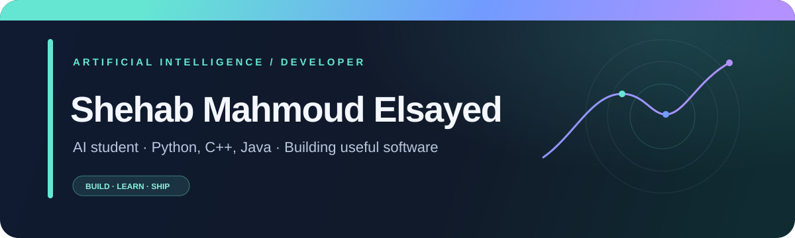

## About me

I'm **Shehab Mahmoud Elsayed**, a student in the **Faculty of Computers and Information**, specializing in **Artificial Intelligence**. I enjoy turning ideas into useful software and expanding my skills across programming, web development, and AI.

- 🎓 Artificial Intelligence student
- 💻 Programming with Python, C++, Java, and HTML
- 🌐 Exploring full-stack development
- 🧠 Growing toward machine learning engineering, with an interest in data mining
- 🚀 Building practical projects and learning by shipping them

## Featured project

<table>
<tr>
<td width="100%">

### 🤖 [Task Agent](https://github.com/shehab1-coding/task_agent)
A Flask chatbot application with a built-in frontend and Gemini integration. Its deployment setup emphasizes secure configuration and production readiness.

`Python` `Flask` `SQLite` `Gemini API`

[Open repository →](https://github.com/shehab1-coding/task_agent)

</td>
</tr>
</table>

## Tech stack

## GitHub at a glance

---

**Building with purpose. Learning every day.**  ·  [Find me on GitHub](https://github.com/shehab1-coding)

